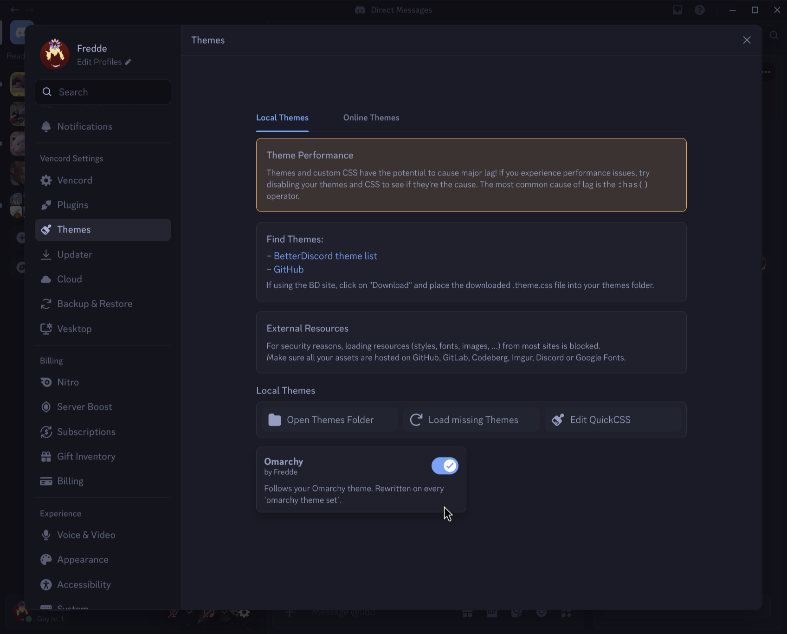
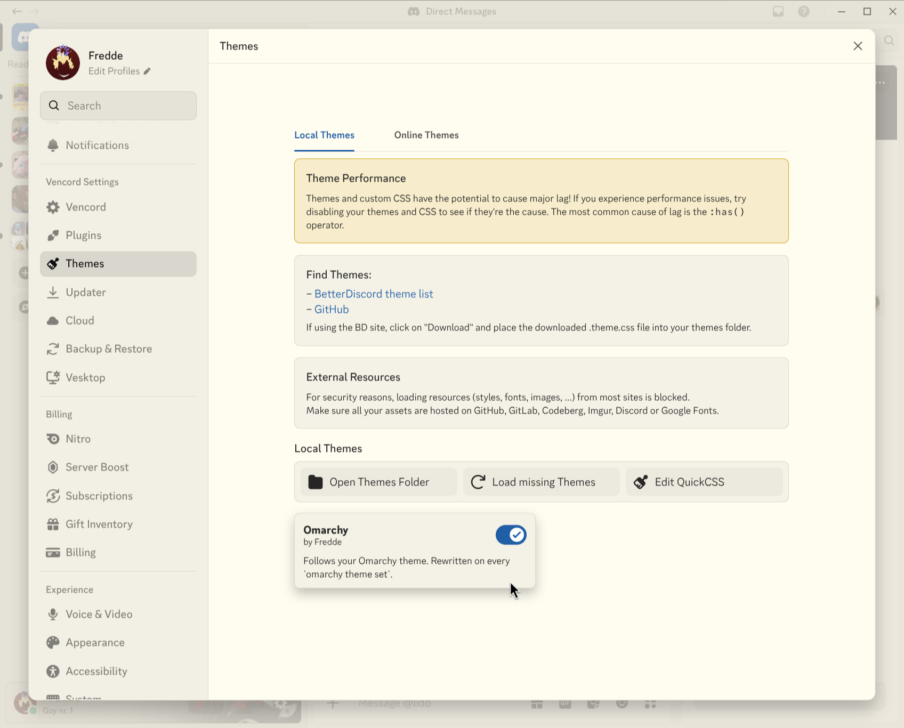
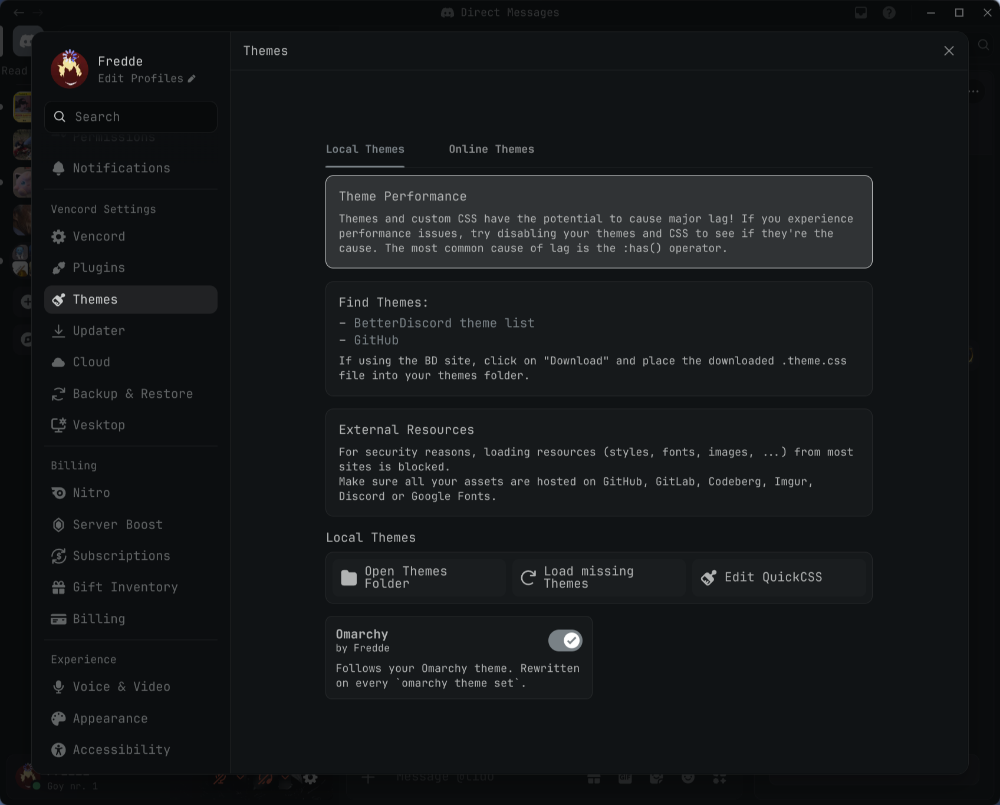

# Omarchy theme for Vesktop

A Vencord theme for [Vesktop](https://github.com/Vencord/Vesktop) that follows your [Omarchy](https://omarchy.org) setup. Switch Omarchy themes and Discord switches with it, no restart.

It takes:

- colors from the current Omarchy theme's `colors.toml`, light themes included
- corner rounding from Hyprland's `decoration:rounding`, the same value the Omarchy shell reads. 0 gives square corners, 8 gives stock Discord. Server icons and the home button (in every hover and selected state), call controls, call and stream tiles, the stream picture-in-picture, menus, the chat input and reactions follow it too.
- the font from `fc-match monospace`, which is what `omarchy font set` changes

It also hides Discord's minimize and maximize buttons, since Hyprland handles windows, and keeps the close button in the top right corner. The inbox and help icons move to the right edge.

Some details that hold on every theme:

- Text over video and images, like the stream picture-in-picture title, keeps Discord's white overlay color.
- Buttons, badges and other filled surfaces get a darker version of the accent when the theme's accent is too light for white text. Catppuccin's pastel blue would otherwise put white labels at about 2:1.
- Links and other accent-colored text get lightened on dark themes and darkened on light ones until they're readable.
- Status colors stay Discord's own: presence dots, connection quality, Voice Connected, notification badges, notices and errors. They carry meaning, and some themes' green or red is a shade of grey.
- ANSI code blocks use the terminal's 16 colors from the theme.
- Popups and menus get a 1px border instead of a blurred shadow, like Hyprland windows.

For light Omarchy themes, turn on Settings > Appearance > "Same as Device Theme" in Discord. Omarchy flips the system color scheme on every theme switch, and Discord then switches between light and dark with it. Discord's dark mode hardcodes white text in a few places that a light palette can't fix.

| Tokyo Night | Flexoki Light | Solitude, rounding 10 |
|---|---|---|
|  |  |  |

## Install

```sh
git clone https://github.com/T3lluz/omarchy-vesktop.git
cd omarchy-vesktop
./install.sh
```

Then open Vesktop, go to Settings > Themes and turn on "Omarchy".

It also writes the theme for Flatpak Vesktop, Vencord on regular Discord, and Equibop if their config folders exist.

## What updates it

| Change | Trigger |
|---|---|
| `omarchy theme set` | `~/.config/omarchy/hooks/theme-set.d/vesktop` |
| `omarchy font set` | `~/.config/omarchy/hooks/font-set.d/vesktop` |
| Rounding changed in `looknfeel.lua` or another Hyprland config | `omarchy-vesktop.service` reruns the sync on Hyprland's `configreloaded` event |

Vencord watches its themes folder, so each rewrite shows up in a second or two.

## Settings

Optional, in `~/.config/omarchy/vesktop.conf`:

```ini
font=all       # Omarchy font everywhere (default)
# font=code    # only in code blocks
# font=none    # keep Discord's fonts
rounding=yes   # "no" keeps Discord's own corner radii
```

Run `omarchy-vesktop-sync` after editing it.

## How it works

- `vesktop.css.tpl` maps Omarchy's palette onto Discord's color variables. The installer puts it in `~/.config/omarchy/themed/`, and Omarchy renders it into the current theme on every switch. A theme that ships its own `vesktop.css` overrides it.
- `omarchy-vesktop-sync` adds rounding and font to those colors and writes `omarchy.theme.css` into the Vencord themes folders.
- `omarchy-vesktop-watch` runs as a user service and listens on Hyprland's event socket for config reloads.

The theme mostly sets Discord's CSS variables, since Discord renames its hashed class names often and variables survive that. The few rules that match elements directly use a stable `role` or `data-` attribute, or a class prefix without the hash (the exception is the chat input's gift, GIF, sticker and emoji buttons, which use a module hash and fall back to stock corners if Discord renames it): the window buttons, Discord's switches (which paint their color from JavaScript), and the handful of corners Discord hardcodes instead of using its radius scale.

## Performance

Measured on a frozen snapshot of a busy Discord channel in headless Chromium, against stock Vesktop:

| | Restyle the whole app | Restyle elements whose classes change |
|---|---|---|
| This theme | about +1% | about +31% |
| Version 1.0 | about +1% | about +36% |

Most of the incremental cost is the corner fixes, since Chrome rechecks each class-prefix selector whenever an element's classes change. A bare `::selection` rule cost more than every color variable combined, so the selection color sits on the root element and descendants inherit it.

## Remove

```sh
./uninstall.sh
```

Then turn the theme off in Vesktop, or leave it. Without the file it does nothing.

## License

MIT
